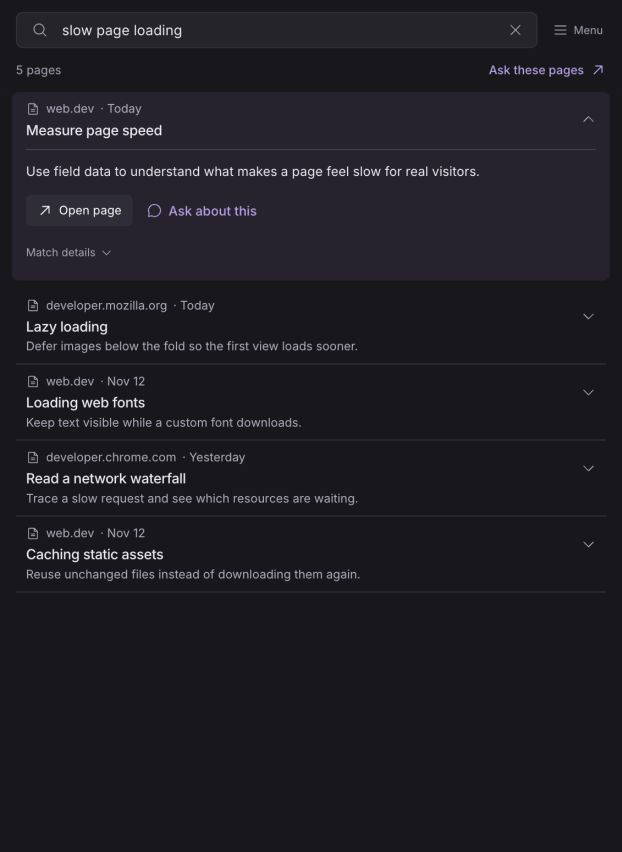
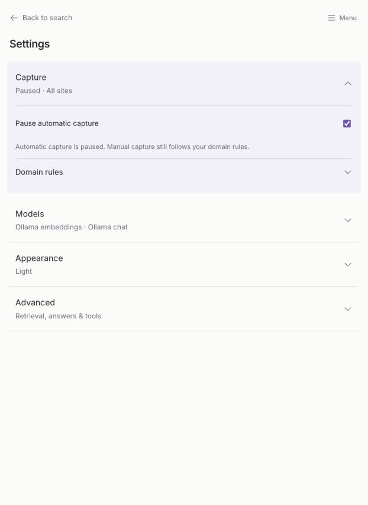
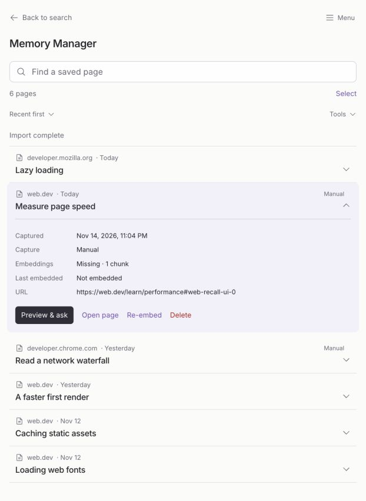
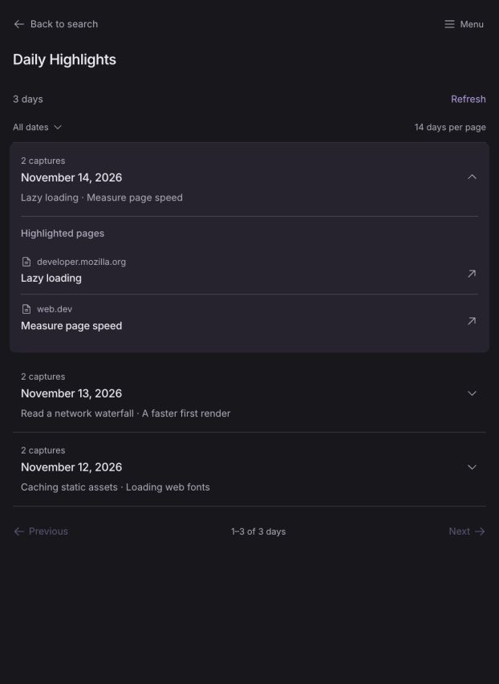
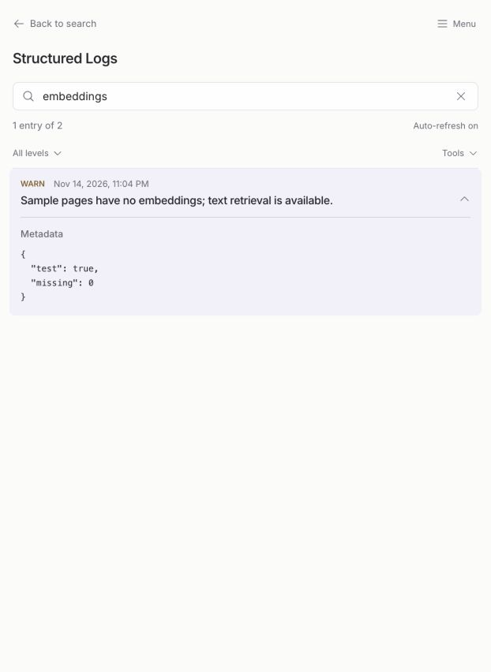
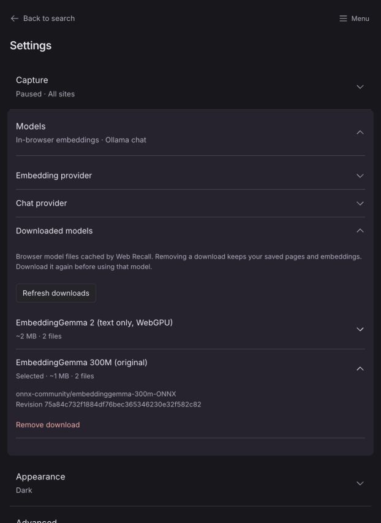
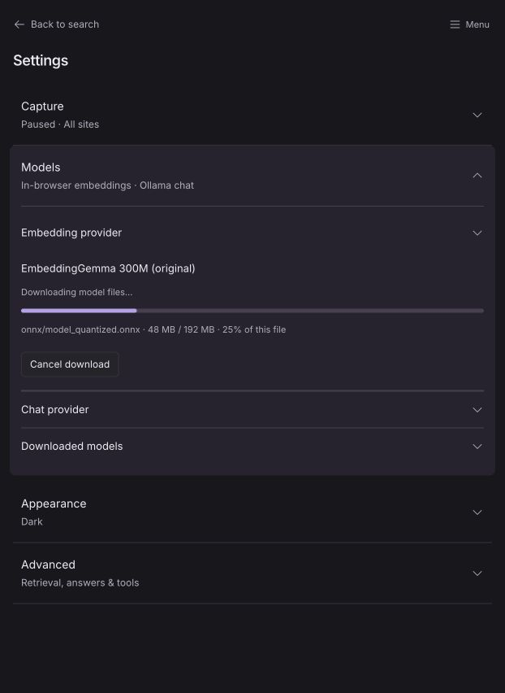

Web Recall
==========

Web Recall is a privacy-preserving Chrome extension. It captures the visible
text of pages you visit, generates semantic embeddings locally via either
Ollama or the optional in-browser runtime, stores the results in your browser,
and provides a side-panel UI for semantic search. You can also ask questions
about what you've read using retrieval-augmented generation (RAG) powered by
locally running models.

Screenshots
-----------

These screenshots show the production UI with an isolated sample library and
unavailable model endpoints. They do not show an installed extension's private data.

**Search and preview saved pages without repeating Chrome's side-panel title.**



Ask remains available inside a preview, with exact page selection and expandable
citations. These screenshots were captured without running Ask or a model.

<details>
<summary>Settings, Memory Manager, Highlights and Logs</summary>

**Settings reveal capture, model, appearance and advanced controls on demand.**



**Review saved pages and their embedding status in Memory Manager.**



**Expand a day to see its highlighted pages, or a log entry to inspect metadata.**





**Inspect and remove browser model downloads in Settings.**

This view uses small, synthetic cache files for visual verification; the displayed
sizes are fixture sizes, not the actual embedding model sizes.



Browser model downloads also show per-file progress, with Cancel and Retry controls.
Completed files are reused on retry; model preparation has its own state.



</details>

Directory contents
------------------

- `manifest.json`: MV3 manifest targeting the bundled `dist/beta/` workspace.
- `src/background/`: service worker modules for capture, embeddings, search,
  Ask, settings, storage orchestration, providers, highlights, logs, and
  offscreen coordination.
- `src/content/`: top-level content script that extracts page text, chunks it,
  and sends capture payloads to the background queue.
- `src/ui/sidepanel/`: the panel shell, inline Search and Ask, and Settings.
- `src/ui/manage/`, `src/ui/highlights/`, `src/ui/logs/`: shared tools mounted
  inside the panel and available as standalone pages.
- `src/ui/shared/`: shared design, navigation, answer rendering and runtime helpers.
- `src/assets/fonts/`, `src/assets/ui/`: bundled Inter and Phosphor assets and licenses.
- `src/shared/`: shared config, IndexedDB helpers, logging, vector math, tools,
  and wasm/offscreen support.

Setup
-----

0. Install Node.js + pnpm

   Use Node.js 24 LTS or newer with pnpm for dependency management. The
   `.nvmrc` file selects the latest Node 24 release, which CI also uses.
   If you use `nvm`, run:

   ```bash
   nvm install
   nvm use
   corepack enable pnpm
   ```

1. Install dependencies

   ```bash
   pnpm install
   pnpm build:beta
   ```

   `pnpm build:beta` bundles all MV3 entrypoints into `dist/beta/` via esbuild.
   Re-run the build whenever you change `src/` or HTML entrypoints.

   Regression tests use an isolated Chromium browser pinned by the development
   dependencies. Install it once before running the suite; Linux also needs the
   system libraries installed by the setup command:

   ```bash
   pnpm test:setup
   pnpm test
   ```

2. Install and start Ollama

   The default runtime uses Ollama for embeddings and local chat/summarisation.
   Install Ollama on your machine and start the server:

   ```bash
   # Install Ollama (see https://ollama.com/download for instructions)
   # Start the Ollama daemon (by default it listens on port 11434)
   ollama serve
   ```

   If Ollama returns **HTTP 403** or a CORS error from the extension, see
   [FIX_OLLAMA_ORIGINS.md](./FIX_OLLAMA_ORIGINS.md) for step-by-step instructions
   to allow your Chrome extension origin.

   Pull the models you want to use. For embeddings pull an embedding model such
   as `embeddinggemma` (default in this repo), `mxbai-embed-large`, or
   `nomic-embed-text`:

   ```bash
   ollama pull embeddinggemma
   ```

   For summarisation and chat, pull one or more instruct-tuned models, such as
   `gpt-oss`, `llama3`, or `gemma:2b`:

   ```bash
   ollama pull llama3
   ollama pull gemma:2b
   ollama pull gpt-oss:latest
   ```

3. Load the extension in Chrome

   * Open `chrome://extensions/` and enable **Developer mode**.
   * Click **Load unpacked** and select the repository root.
   * Ensure `pnpm build:beta` has been run so `dist/beta/` exists.
   * In DevTools -> Service Workers, verify the console logs
     `[beta-background] Initialising service worker` without errors.

4. Configure capture + embeddings in the side panel

   * Open Web Recall in Chrome's side panel, then choose **Menu → Settings**.
   * Open **Capture** for capture rules and **Models** for embedding and chat providers.
   * Toggle **Pause automatic capture**, add allowlist/denylist domains (one per line), and click **Save capture rules**.
   * Enter the Ollama base URL/model in **Embedding provider** and click **Save embedding settings**.
   * Optional: switch the embedding provider to **In-browser (experimental)** and
     choose **EmbeddingGemma 300M (original)** or **EmbeddingGemma 2 (text only, WebGPU)**.
     The original model remains the default. **Save embedding settings** changes
     the selection; **Save & download model** also downloads and prepares it.
     EmbeddingGemma 2 requires WebGPU and loads only q4 text weights (about 175 MB,
     plus tokenizer files). The original model uses q8 WASM and works without WebGPU.
     Both options use pinned model revisions and process page text on this device.
     Switching models does not re-embed stored pages. Use **Re-embed** in Memory
     Manager to replace their vectors explicitly; **Fill missing** preserves existing
     vectors, including those from another model. Search combines text matches with
     vectors from the selected model. Older pages remain searchable by text; explicit
     re-embedding enables semantic matches with the new model.
     If the browser runtime is not available, the extension will report an error.
     Download progress appears under **Embedding provider** in Models, with the
     current file's bytes and percentage when its size is known. **Preparing model**
     follows file transfer; 100% of a file does not mean the model is ready yet.
     **Cancel download** stops active requests. **Retry download** reuses completed
     cached files; an unfinished file is fetched again. Reopening Models restores
     the current transfer while the extension's offscreen document remains open.
   * Open **Models → Downloaded models** to inspect browser-cached models and
     revisions, file counts and estimated sizes. Expand a row to **Use model** or
     **Remove download**. Removal confirms inline and affects only that revision;
     saved pages and their vectors are kept. The selected model is marked even
     when its row is collapsed. Incomplete downloads without a model graph are
     labeled **Partial download**; sizes are unavailable when cache headers omit them.
     Search and capture use cached files only. Use **Save & download model** to
     download missing or removed files explicitly.
   * Return to search and run a smoke query to ensure captured pages appear and the runtime path works.

5. Browse as usual

   After visiting pages, open the side panel. The extension captures visible
   text from pages you visit, embeds it locally, and stores the vectors in your
   browser.

   Search retrieves captured pages. Expand a result and choose **Ask about this**
   to ask within that page. **Ask these pages** uses the displayed results; its
   **Using N pages** disclosure lets you inspect and change the exact selection.
   Tools remain within those selected saved URLs. Open a numbered citation to
   inspect the captured evidence, then **Open page** to visit the original URL.
   Follow-up questions retain the conversation for that page selection until
   you clear it or close the panel. **Menu → Ask your memory** searches the library.

6. Manage & inspect captures

   - **Menu → Memory Manager**: search and expand saved pages, preview and ask,
     re-embed, or delete. **Select** enables bulk selection. **Tools** contains
     backup import/export, capture queue and embedding maintenance.
     See [Export/Import](#exportimport) for the backup format.
   - **Menu → Highlights**: browse days and expand their highlighted page links.
     Open **All dates** for a date range and page size.
   - **Menu → Logs**: search entries, choose an exact level, and expand metadata.
     **Tools** contains auto-refresh, manual refresh, clear and logging settings.
   - **Menu → Capture current tab** manually captures the current page.
     **Capture queue** exposes retry controls; **Refresh pages** refreshes recents
     or reruns the current query.

   The queue appears below Search while captures are active or failed. When idle,
   it stays hidden unless opened from Menu; closing the empty queue hides it again.
   An empty library offers a direct capture action and a capture settings link.

   Chrome's **Extension options** still opens Memory Manager. Standalone
   Highlights and Logs remain at `dist/beta/ui/highlights/index.html` and
   `dist/beta/ui/logs/index.html` under the extension origin.

7. Use chat, tools, and model selection (optional)

   Under **Settings → Models**, open **Embedding provider** or **Chat provider**.
   Use **Save provider**, **Test connection**,
   and **Refresh models** to configure the Ollama base URL and active chat
   model. The connection test probes the actual chat endpoint, which helps
   surface `OLLAMA_ORIGINS` misconfiguration.

   Configure the final provider endpoint URL directly: redirects, including
   same-origin redirects, are rejected. Remote-origin consent is checked before
   each request and embedding retry; revoking consent stops subsequent requests.

   If Tools are enabled, Ask can call:
   - `search_memory({ query, k? })`
   - `get_page_summary({ url })`
   - `get_page_chunks({ url, limit? })`
   - `search_within_page({ url, query, k? })`
   - `fetch_more({ url, chunkIndex })`
   - `fetch_more({ url, aroundChunkIndex, radius })`
   - `fetch_more({ url, start, end })`

   **Settings → Advanced** contains retrieval, answer, tool and logging controls.
   `Max tool steps = 0` means no user-imposed limit. Model inference has no
   automatic timeout; use **Stop** to cancel. Auto's initial source count is a
   retrieval starting point, not a hard cap on citations.

8. Shortcuts and context menu

   - Keyboard: `Ctrl+Shift+Y` (Windows/Linux) or `Command+Shift+Y` (macOS) opens
     the side panel.
   - Within the panel, `Ctrl+K` / `Command+K` returns to search. Arrow keys move
     between results; Escape closes the source chooser, Ask or an open preview,
     or returns from a utility page. Enter sends a question; Shift+Enter adds a line.
   - Right-click: open the panel, capture the current page now, search the
     current selection, toggle pause, or open Highlights.

9. Capture rules and pause

   - Configure allowlist/denylist domain rules in Settings. When the allowlist
     is non-empty, only listed domains are captured. Use the Pause toggle to
     temporarily stop auto-capture.

Upgrading from 0.1.0
--------------------

The first storage read copies the previous IndexedDB library into the 0.2.0 database,
including captured passages, existing vectors, summaries, and version history.
Existing 0.2.0 captures take precedence, and the old versions remain available in
exports. Migration completes atomically and is recorded once, so deleted pages are
not imported again after a restart. No embeddings are regenerated during migration.

The original `webMemoryDB` database is retained as a local upgrade backup. Memory
Manager deletions affect the active 0.2.0 library, not this retained backup. Legacy
schema-version-1 JSON backups can also be imported without dropping their passages.

Development preview
-------------------

After building, `node tests/ui-preview.mjs` serves the production bundles at
`http://127.0.0.1:4180/` with isolated IndexedDB fixtures and a test model. It
does not access installed-extension data or a live provider. This supports visual
QA; extension permissions, capture and live model behavior still require an
unpacked-extension check in Chrome.

Use `node tests/ui-preview.mjs --offline --empty --port 4181` to review an empty
library with unavailable model endpoints. Import sample backup data through
Memory Manager to exercise text search and utility pages without a model.

Add `--model-cache` on a separate port to seed synthetic model files in that
localhost origin and exercise inventory/removal through the browser Cache API.
These are non-runnable fixtures; they do not access the installed extension's cache.

Release
-------

- Workspace version: `0.2.2` (unreleased).
- See [CHANGELOG.md](./CHANGELOG.md) for details.

Security and privacy
--------------------

* The extension never sends your browsing data to any remote server by default.
  Embeddings run either against your local Ollama server or locally in-browser
  via the optional downloaded model.
* Ask tools operate only on stored page URLs and captured content already in
  memory. `fetch_more` can expand a page already returned by memory search, but
  it does not fetch arbitrary uncaptured URLs.
* Host permissions include `<all_urls>` to enable capture and page-scoped
  actions; the extension does not exfiltrate page content.

Limitations
-----------

* Semantic search still uses a browser-local retrieval pipeline over stored
  embeddings; larger datasets will need more aggressive optimization.
* Reranking uses a local chat model. Keep candidate sets small for predictable latency.
* Memory Manager and logs are functional but still likely to evolve.

Export/Import
-------------
- Restore waits for pending capture admissions and cancels existing work for each restored URL, so an older capture cannot overwrite the restored text and embeddings. New captures requested afterward can update the page normally.
- Restores replace the saved page, including its summary, history and embedding timestamp. Optional fields omitted from a backup are cleared rather than inherited from the destination; the last-modified timestamp records the restore itself.
- **Export backup** saves one `.jsonl` file using Chrome's native save dialog. Records stream from IndexedDB to disk one page at a time, so the whole library is not assembled in memory. Keep the library unchanged during export for a consistent backup.
- **Import backup or JSON** accepts the streaming backup and legacy JSON files. Backups are validated completely before any pages are restored; malformed or truncated files are rejected. A storage failure during restore can leave already imported pages in place; the error reports how many finished.
- Streaming backups use a `{"format":"web-recall","schemaVersion":2}` header, one `{"type":"page","page":{...}}` record per line, and a `{"type":"end","pages":N}` footer. Total file size and page count are not capped. Each UTF-8 record is limited to 16 MiB to bound memory and stay within Chrome's messaging limits. Export rejects oversized records without committing an incomplete file.
- Legacy JSON imports retain their 10 MiB file and 2,000-page limits and per-field validation. They accept page arrays or an object with a `pages` array; a numeric `schemaVersion`, when provided, must be `1`. Use streaming backups for larger libraries and historical captures beyond legacy field limits.
- Imported vectors are preserved. Pages with missing embeddings or a different/unknown embedding model need to be re-embedded before semantic search can use them.
