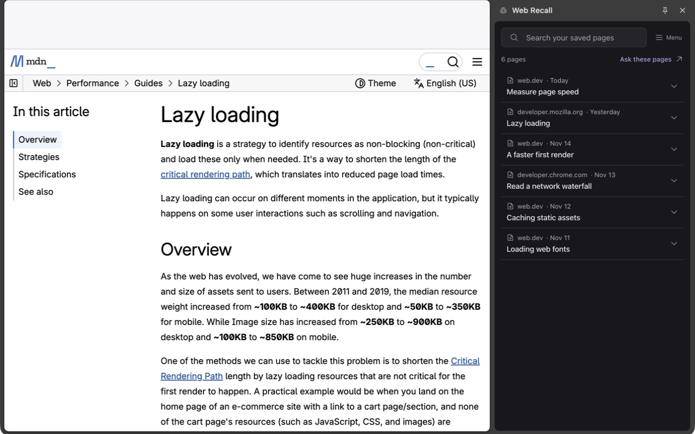
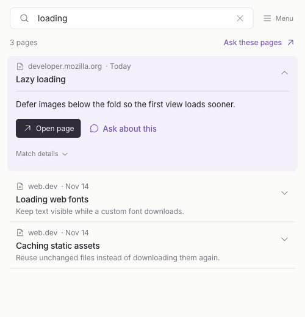
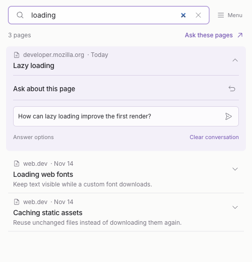
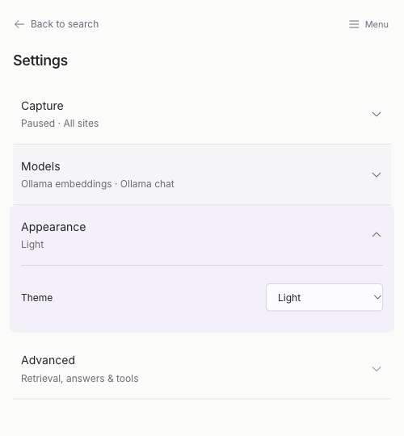
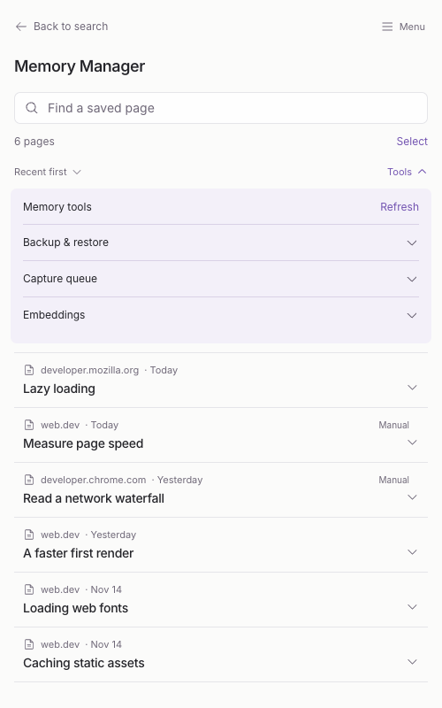
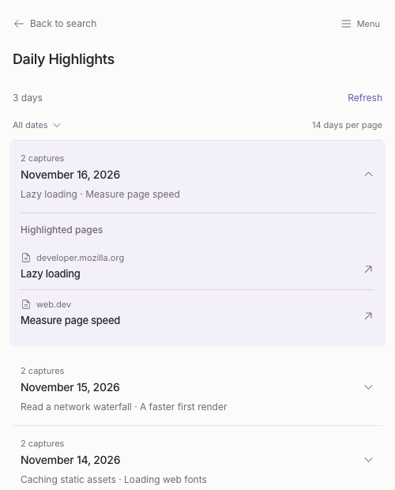
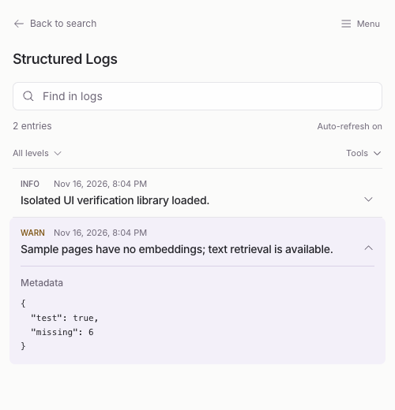

Web Recall
==========

Web Recall is a privacy-preserving Chrome extension. It captures the visible
text of pages you visit, generates semantic embeddings locally via either
Ollama or the optional in-browser runtime, stores the results in your browser,
and provides a side-panel UI for semantic search. You can also ask questions
about what you've read using retrieval-augmented generation (RAG) powered by
locally running models, including Apple's on-device Foundation Models through
the optional [Mac companion](#mac-companion).

Screenshots
-----------

Shown with sample pages.

**Search saved pages alongside the page you're reading.**



<details>
<summary>More screenshots: Search, Ask, Settings, Memory, Highlights and Logs</summary>

**Search and preview saved pages.**



**Ask about an individual page or your search results.**



**Settings reveal capture, model, appearance and advanced controls on demand.**



**Manage saved pages, backups and embeddings.**



**Expand a day to see its highlighted pages, or a log entry to inspect metadata.**





</details>

Mac companion
-------------

The optional **Web Recall Mac companion** runs Ask and background page summaries
with Apple Foundation Models instead of an Ollama chat model. Your saved pages
and embeddings stay in Chrome; the companion does not store a second library.
Keep the app running while using the Apple provider.

### Requirements

- An Apple Silicon Mac running macOS 26.4 or newer, with Apple Intelligence
  enabled and its on-device model available.
- Google Chrome 142 or newer with Web Recall installed.
- To build from source: Xcode 27 with its Swift toolchain selected, Node.js 24
  or newer, and pnpm. See [Setup](#setup) for the Node.js and pnpm commands.

### Installation

1. From this repository's root, install dependencies and build the app:

   ```sh
   pnpm install
   pnpm apple:build
   ```

2. Open `chrome://extensions` and copy Web Recall's extension ID. Register that
   exact ID, replacing `YOUR_EXTENSION_ID` below:

   ```sh
   node scripts/install-apple-host.mjs --extension-id YOUR_EXTENSION_ID
   ```

   The installer copies the app to `~/Applications/Web Recall.app` and registers
   its native messaging bridge in Google Chrome's default user-data directory.
   Add `--dry-run` to inspect the installation paths and registration without
   changing anything. Opening the app alone does not register it with Chrome.

3. Open `~/Applications/Web Recall.app`. Its menu-bar icon provides **Open
   dashboard**, **Pause / Resume native inference**, **Stop active work** and
   **Quit**. Closing the dashboard leaves the app running; **Launch at login**
   is optional.

### Connect to Chrome

1. Open Web Recall's sidepanel, then **Menu → Settings → Models → Chat provider**.
2. Select **Apple Foundation Models** and grant Chrome's optional native-app
   permission when prompted.
3. Use **Test connection** to check model availability and the detected context
   size. If Chrome cannot find the bridge, rerun the registration command with
   the ID of the extension you are currently using.
4. Keep your current embedding provider, or select **In-browser EmbeddingGemma**
   for browser-local embeddings. Changing the chat provider does not regenerate
   existing vectors. Open a saved page and ask a question to try Apple inference.

**Pause** and **Stop** affect native inference, not browser capture. **Quit**
disconnects Chrome; reopen the app to reconnect. Private Cloud Compute is off by
default and is not required for on-device use.

Protecting your library
-----------------------

Saved pages, summaries, embeddings and the capture queue live together in a
SQLite database in the extension's private storage in your Chrome profile.
The extension requests `unlimitedStorage` to exempt its library and browser-model
cache from Chrome's storage eviction. Saving reports success only after the
library transaction commits. Local diagnostic logs still use IndexedDB.
Browser-model files use Cache Storage, which has no equivalent strict-durability
option. Eviction protection is not a guarantee against losing cached files in a
crash. Missing files require an explicit download; saved pages remain independent.

This is not a backup: uninstalling the extension, removing the Chrome profile,
storage corruption or disk failure can still lose data. Use **Settings →
Storage & backups** to set up a recovery key, save an encrypted `.wrbackup`
file, or restore a backup. Keep the recovery key separate from the backup
folder: you'll need it to restore the encrypted file in another profile.
Legacy JSON and JSONL backups can still be restored.

For automatic encrypted backups, choose a folder in the updated Mac companion
dashboard, then enable daily backups in **Mac companion folder**. Chrome and
the companion must be running. Web Recall skips unchanged libraries and keeps
the last three successful encrypted backups by default. It encrypts files
before writing them to the folder and never uploads them. If you sync the
folder yourself, move older unencrypted `.jsonl` backups out of it first.

Use **Memory Manager → Page actions → Export pages** to save readable, unencrypted copies of all, filtered, or
selected pages as Markdown or JSON.

Directory contents
------------------

- `manifest.json`: MV3 manifest targeting the bundled `dist/beta/` workspace.
- `src/background/`: service worker modules for capture, embeddings, search,
  Ask, settings, storage orchestration, providers, highlights, logs, and
  offscreen coordination.
- `src/content/`: top-level content script that extracts page text, chunks it,
  and sends capture payloads to the background queue.
- `src/ui/sidepanel/`: the panel shell, inline Search and Ask, and Settings.
- `src/ui/manage/`, `src/ui/highlights/`, `src/ui/logs/`: shared tools mounted
  inside the panel and available as standalone pages.
- `src/ui/shared/`: shared design, navigation, answer rendering and runtime helpers.
- `src/assets/fonts/`, `src/assets/ui/`: bundled Inter and Phosphor assets and licenses.
- `src/shared/`: shared config, local storage, logging, vector math, tools,
  and wasm/offscreen support.

Setup
-----

Saving, text search and saved-page reading do not require a model, account or
Mac companion. After loading Web Recall, capture a page, search a few words
from its title or text, then choose **Read saved page**. The inline guide can
be skipped and does not repeat after completion.

New installations keep **Settings → Models → Use AI automatically** off.
Enable it when you want summaries and indexing for new captures and model-based
Search refinement. Enabling this does not backfill existing pages or download models.
On new installations the chat provider is also **Disabled**. Choose a provider
under **Settings → Models → Chat provider** to show Ask. This is separate from
automatic AI and embeddings. Ask, manual re-embedding, summary regeneration and
model downloads remain explicit actions. Upgrades preserve existing model choices
and retrieval preferences.

0. Install Node.js + pnpm

   Use Node.js 24 LTS or newer with pnpm for dependency management. The
   `.nvmrc` file selects the latest Node 24 release, which CI also uses.
   If you use `nvm`, run:

   ```bash
   nvm install
   nvm use
   corepack enable pnpm
   ```

1. Install dependencies

   ```bash
   pnpm install
   pnpm build:beta
   ```

   `pnpm build:beta` bundles all MV3 entrypoints into `dist/beta/` via esbuild.
   Re-run the build whenever you change `src/` or HTML entrypoints.

   Regression tests use an isolated Chromium browser pinned by the development
   dependencies. Install it once before running the suite; Linux also needs the
   system libraries installed by the setup command:

   ```bash
   pnpm test:setup
   pnpm test
   ```

2. Install and start Ollama (optional)

   Ollama is an optional provider for embeddings and local chat/summarisation.
   If you want these AI features, install Ollama and start the server:

   ```bash
   # Install Ollama (see https://ollama.com/download for instructions)
   # Start the Ollama daemon (by default it listens on port 11434)
   ollama serve
   ```

   If Ollama returns **HTTP 403** or a CORS error from the extension, see
   [FIX_OLLAMA_ORIGINS.md](./FIX_OLLAMA_ORIGINS.md) for step-by-step instructions
   to allow your Chrome extension origin.

   Pull the models you want to use. For embeddings pull an embedding model such
   as `embeddinggemma` (default in this repo), `mxbai-embed-large`, or
   `nomic-embed-text`:

   ```bash
   ollama pull embeddinggemma
   ```

   For summarisation and chat, pull one or more instruct-tuned models, such as
   `gpt-oss`, `llama3`, or `gemma:2b`:

   ```bash
   ollama pull llama3
   ollama pull gemma:2b
   ollama pull gpt-oss:latest
   ```

3. Load the extension in Chrome

   * Open `chrome://extensions/` and enable **Developer mode**.
   * Click **Load unpacked** and select the repository root.
   * Ensure `pnpm build:beta` has been run so `dist/beta/` exists.
   * In DevTools -> Service Workers, verify the console logs
     `[beta-background] Initialising service worker` without errors.

4. Configure capture + embeddings in the side panel

   * Open Web Recall in Chrome's side panel, then choose **Menu → Settings**.
   * Open **Capture** for capture rules and **Models** for embedding and chat providers.
   * Toggle **Pause automatic capture**, add allowlist/denylist domains (one per line), and click **Save capture rules**.
   * Enter the Ollama base URL/model in **Embedding provider** and click **Save embedding settings**.
   * Optional: switch the embedding provider to **In-browser (experimental)** and
     choose **EmbeddingGemma 300M (original)** or **EmbeddingGemma 2 (text only, WebGPU)**.
     The original model remains the default. **Save embedding settings** changes
     the selection; **Save & download model** also downloads and prepares it.
     EmbeddingGemma 2 requires WebGPU and loads only q4 text weights (about 175 MB,
     plus tokenizer files). The original model uses q8 WASM and works without WebGPU.
     Both options use pinned model revisions and process page text on this device.
     Switching models does not re-embed stored pages. Use **Re-embed** in Memory
     Manager to replace their vectors explicitly; **Fill missing** preserves existing
     vectors, including those from another model. Search combines text matches with
     vectors from the selected model. Older pages remain searchable by text; explicit
     re-embedding enables semantic matches with the new model.
     If the browser runtime is not available, the extension will report an error.
     Download progress appears under **Embedding provider** in Models, with the
     current file's bytes and percentage when its size is known. **Preparing model**
     follows file transfer; 100% of a file does not mean the model is ready yet.
     Preparation releases the downloaded model and loads it again from cache
     without network access before reporting success. After a browser restart,
     cached files are shown as unverified until the model is next used; a previous
     ready flag does not prove the files are still present or complete.
     **Cancel download** stops active requests. **Retry download** reuses completed
     cached files; an unfinished file is fetched again. Reopening Models restores
     the current transfer while the extension's offscreen document remains open.
   * Open **Models → Downloaded models** to inspect browser-cached models and
     revisions, file counts and estimated sizes. Expand a row to **Use model** or
     **Remove download**. Removal confirms inline and affects only that revision;
     saved pages and their vectors are kept. The selected model is marked even
     when its row is collapsed. Incomplete downloads without a model graph are
     labeled **Partial download**; sizes are unavailable when cache headers omit them.
     Search and capture use cached files only. Use **Save & download model** to
     download missing or removed files explicitly.
   * Return to search and run a smoke query to ensure captured pages appear and the runtime path works.

5. Browse as usual

   After visiting pages, open the side panel. The extension captures visible
   text from pages you visit, embeds it locally, and stores the vectors in your
   browser.

   Search retrieves captured pages. Expand a result and choose **Ask about this**
   to ask within that page. **Ask these pages** uses the displayed results; its
   **Using N pages** disclosure lets you inspect and change the exact selection.
   Tools remain within those selected saved URLs. Open a numbered citation to
   inspect the captured evidence, then **Open page** to visit the original URL.
   Follow-up questions keep earlier answers visible, and sending clears the
   composer immediately. Longer conversations compact older context for the
   selected model while keeping the full visible chat and stable source IDs.
   Each page selection has a separate conversation. These chats stay in the
   current panel session. Individual-page questions keep running when another
   item is opened; the item's status indicates when its answer is ready. Stop
   affects only the displayed chat. Saved-text previews use Show more/Show less
   without making a model request. These chats are
   not a persistent chat archive; Clear conversation,
   replacing/deleting memory, or closing the browser panel clears them.
   **Menu → Ask your memory** searches the library.

   After capture is saved, background summarization uses your selected chat
   provider and model. Unchanged pages reuse their saved summary; changed text
   invalidates it. Previews show the summary when ready, otherwise saved text.
   Capture and embeddings remain saved even if the chat model is unavailable.
   In **Memory Manager → Maintenance**, select **Create missing summaries after
   embeddings** to summarize older pages after backfill. This also includes pages
   whose embeddings are already complete and never replaces existing summaries.
   To replace an older or poor summary, select **Regenerate existing summaries
   too** and run **Backfill**. This explicitly rebuilds summaries within the page
   limit; it does not force replacement embeddings. Summaries use independent
   section notes followed by a whole-page overview, rather than keeping only the
   final section's rolling summary. A failed regeneration keeps the old summary.
   For just one page, expand its Memory Manager row and choose **Regenerate
   summary**. This does not generate or replace embeddings or touch other pages.
   The button becomes **Stop summary** while working; failures keep the old summary.
   An individual page's **Re-embed** also creates its missing summary afterward,
   regardless of the bulk checkbox; an existing summary is kept unchanged.
   **Stop** cancels that backfill's pending model work.

6. Manage & inspect captures

   - **Menu → Memory Manager**: search and expand saved pages, preview and ask,
     re-embed, or delete. **Select** enables bulk selection. **Page actions**
     contains export and the capture queue; **Maintenance** contains bulk model work.
     **Backups** opens Storage & backups in Settings.
     See [Export/Import](#exportimport) for the backup format.
   - **Menu → Highlights**: browse days and expand their highlighted page links.
     Open **All dates** for a date range and page size.
   - **Menu → Logs**: search entries, choose an exact level, and expand metadata.
     **Tools** contains auto-refresh, manual refresh, clear and logging settings.
   - **Menu → Capture current tab** manually captures the current page.
     **Capture queue** exposes retry controls; **Refresh pages** refreshes recents
     or reruns the current query.

   The queue appears below Search while captures are active or failed. When idle,
   it stays hidden unless opened from Menu; closing the empty queue hides it again.
   An empty library offers a direct capture action and a capture settings link.

   Recents show a small browser-session snapshot immediately on reopening and
   refresh from local storage as soon as the panel becomes visible. Only the
   latest 20 titles, URLs and timestamps are cached—not saved text or vectors.
   Older pages load in batches as you scroll, with **Load more** available for
   keyboard use. Deletion and imports invalidate the snapshot. The session
   cache clears on browser restart or extension reload; your saved library
   remains saved. These refreshes do not run models or regenerate embeddings.

   Chrome's **Extension options** still opens Memory Manager. Standalone
   Highlights and Logs remain at `dist/beta/ui/highlights/index.html` and
   `dist/beta/ui/logs/index.html` under the extension origin.

7. Use chat, tools, and model selection (optional)

   Under **Settings → Models**, open **Embedding provider** or **Chat provider**.
   Use **Save provider**, **Test connection**,
   and **Refresh models** to configure the Ollama base URL and active chat
   model. The connection test probes the actual chat endpoint, which helps
   surface `OLLAMA_ORIGINS` misconfiguration.

   **Apple Foundation Models:** Follow [Mac companion](#mac-companion) for
   requirements, installation and connecting Chrome. Its dashboard shows model
   availability, context size, connections and operation outcomes—not prompts
   or page contents.

   **Companion updates:** The dashboard offers **Check for updates**
   and **Install & restart**. **Automatic updates** is off by default. When
   enabled, the app checks GitHub at startup and daily, verifies the signed
   release, and waits for active inference to finish before restarting.
   You can cancel the download or wait. A failed startup restores and
   relaunches the previous app; failed automatic versions are not retried
   automatically. Updates replace only the companion, not Chrome's saved
   pages, models, settings or extension. Keep the app at
   `~/Applications/Web Recall.app`, in a directory owned by your user.
   Existing companions without the updater need one manual installation.
   **Refresh model status** checks Apple's on-device model readiness and
   reported context size; it does not check GitHub or generate an answer.

   Release maintainers generate the dedicated updater key once with
   `pnpm apple:update:keygen`: its private key stays in macOS Keychain and
   only `native/apple/update-public-key.txt` belongs in Git. Do not regenerate
   or replace that public key for an ordinary release. After building,
   `pnpm apple:package` produces the companion ZIP and signed update metadata
   in `dist/apple-release/`. Pull requests run native regression tests; companion
   app assembly, signing and packaging run only for release tags. Tag builds use
   the matching `APPLE_UPDATE_SIGNING_KEY` Actions secret and attach both assets
   to the GitHub release. This key is separate from the Chrome extension key and
   from Apple's Developer ID signing identity.

   Ask streams answers with saved-source citations and supports **Stop**.
   The menu bar uses the extension mark and shows operational status; the
   dashboard contains the reported Apple model and app version. On macOS 27,
   the model name comes from Apple's
   runtime variant API rather than an assumed model version.
   When tools are enabled, Apple uses the same browser-owned saved-memory
   tools as Ollama. It can discover additional saved pages in a library-wide
   Ask, or stay strictly within a page selection. Only bounded previews and
   requested passages cross the native bridge, not a whole-library copy.
   The helper queries the model's actual
   context size and budgets prompts and tool output against it. It stores no
   library and runs no HTTP server. The Chrome bridge talks to the running
   companion over a same-user, executable-checked private Unix socket.
   **Pause** cancels native work and blocks new model requests, but does not
   pause browser capture. **Quit** cancels native work and disconnects Chrome;
   the bridge never silently launches the companion again. Reopen the app to
   reconnect. Browser embeddings and saved-page reading remain independent.
   When research context fills, the same selected model compacts working notes
   and continues with stable evidence references. If the tool-call allowance
   is exhausted, or recovery still finds no new evidence, it finishes from
   already-read evidence without more tools.
   It does not retry unrelated failures, switch providers, bypass Stop, or
   introduce an inference timeout. Apple citations are rendered from structured
   source IDs; an honest insufficient-evidence response does not need a citation.

   **Private Cloud Compute is off by default.** Its separate switch requires
   confirmation because prompts and selected passages leave the Mac. It also
   requires macOS 27, network access, Apple eligibility, and a companion signed
   with Apple's managed PCC entitlement. The locally built companion does not
   include that entitlement. An unavailable Apple mode fails explicitly;
   neither cloud mode nor Ollama is selected as a silent fallback.

   Local and CI builds use ad-hoc macOS code signatures unless
   `APPLE_CODESIGN_IDENTITY` is supplied; update signatures do not replace
   Developer ID signing or notarization for public Mac distribution. The
   updater does not disable Gatekeeper or remove quarantine. Run
   `pnpm apple:test` for deterministic protocol, tool and lifecycle
   checks. After `pnpm apple:build:debug` and
   `pnpm build:beta`, the advisory command
   `node tests/apple-native-smoke.mjs --allow-local-inference` exercises real
   on-device Ask, citations, and Stop in an isolated Chrome for Testing
   profile with synthetic pages. It uses no existing Chrome profile or PCC,
   removes its temporary host registration, and is not part of `pnpm test`.

   Configure the final provider endpoint URL directly: redirects, including
   same-origin redirects, are rejected. Remote-origin consent is checked before
   each request and embedding retry; revoking consent stops subsequent requests.

   If Tools are enabled, Ask can call:
   - `search_memory({ query, k?, offset? })`
   - `get_page_summary({ url })`
   - `get_page_chunks({ url, limit?, offset? })`
   - `search_within_page({ url, query, k?, offset? })`
   - `fetch_more({ url, chunkIndex, offset, limit? })`

   **Settings → Advanced** contains retrieval, answer, tool and logging controls.
   `Max tool calls = 0` means no user-imposed limit; a 100-call safety allowance
   still applies. Follow `nextArgs` to continue bounded reads or result pages.
   Model inference has no automatic timeout; use **Stop** to cancel. Auto's
   initial source count is a retrieval starting point, not a hard cap on citations.
   Repeated lookups carry their original evidence plus a no-progress notice;
   the loop can reorganize its context but will not spend the whole allowance
   repeating unchanged reads.

8. Shortcuts and context menu

   - Keyboard: `Ctrl+Shift+Y` (Windows/Linux) or `Command+Shift+Y` (macOS) opens
     the side panel.
   - Within the panel, `Ctrl+K` / `Command+K` returns to search. Arrow keys move
     between results; Escape closes the source chooser, Ask or an open preview,
     or returns from a utility page. Enter sends a question; Shift+Enter adds a line.
   - Right-click a page, selected text, link or image → **Web Recall → Capture
     this page**. This captures the current tab, not just the selected text or
     linked page. **Open Web Recall** opens the panel. The extension toolbar's
     right-click menu also offers **Pause capture / Resume capture**.

9. Capture rules and pause

   - Choose **Manual only**, **Selected sites**, or **Enable broad capture** at
     first setup. Broad capture includes all non-excluded sites; manual saving
     does not require model setup.
   - **Menu → Pause automatic capture / Resume automatic capture** changes
     automatic collection without stopping indexing of already-saved pages.
     **Never save current site** adds the current site's domain to exclusions,
     including subdomains. This keeps existing saves.
   - Configure allowlist/denylist domain rules in Settings. When the allowlist
     is non-empty, only listed domains are captured. Exclusions always win,
     including manual saves. Pause stops automatic collection; explicit saving
     still works, and already-saved pages may continue indexing.
   - Automatic capture waits for 1.5 seconds of DOM quiet in a visible, focused
     page. A continuously changing page is attempted after 20 seconds; empty or
     failed attempts remain eligible for later content. Switching away resets
     the wait. A background tab alone is not saved.
     Navigation starts a new wait; after a successful automatic save, use
     **Capture current tab** to refresh later content changes at the same URL.
   - Capture confirmation means the text and indexing job have been durably
     saved. Text search and the saved reader work while model indexing waits
     or fails. The capture queue distinguishes waiting, indexing and failure;
     check model settings and choose **Retry** for failed indexing.
     With automatic AI off, the saved text stays usable without starting model
     work. Turning it off stops pending automatic enrichment and Search refinement;
     it does not remove existing vectors or summaries, or cancel explicit Ask and
     manual maintenance requests.
   - **Memory Manager → Page actions → Forget saved pages** reviews pages by site,
     capture dates, or both. Confirm the displayed version and page counts to
     remove only reviewed matching versions, including versions marked Keep.
     Other versions remain. If the current version is removed, the newest
     remaining version becomes current; a page disappears only when no versions
     remain. Changed scope requires another review, newly captured versions are
     not silently included, and capture dates are rechecked at deletion.
     Matching indexing and summary work is cancelled after the removal commits;
     unrelated versions and newer jobs continue. A failed transaction retains
     both the saved versions and their active work, so the same review can retry.
     Forgetting affects this library, not exported or retained legacy backups,
     and does not prevent future saves. Exclude the site separately if needed.
   - Successful Memory re-embedding clears an obsolete capture-indexing error
     for that saved capture. A newer job or a failed backfill is not discarded.

### Saved content and versions

Saved text remains readable and searchable without a model. Extraction preserves
headings, lists, code blocks and table cell text; the saved reader does not run
the original page's scripts or load its images.

| Page type | What is saved | Limitations |
| --- | --- | --- |
| Articles | Visible article text and reading structure | Surrounding navigation, ads and unrelated sidebars are omitted. |
| Documentation | Visible main content, code, lists and tables | Interactive examples and embedded documents are not executed or read. |
| Forums | Visible discussion text, including multiple posts | Only loaded posts are captured; pagination and collapsed replies are not opened automatically. |
| Dynamic pages | Useful text visible after the capture dwell | Later same-URL changes require another manual capture. Hidden content is not expanded. |
| PDF or embedded-only pages | Not supported by this text extractor | Open a supported HTML page instead. Mixed pages show a partial-capture notice when embedded or collapsed content is omitted. |

Recapturing changed text or a changed title creates a saved version. An unchanged
capture records another observation without duplicating the content; re-embedding
only updates the existing saved text's index. Memory shows first save and latest
capture times. **Saved versions** opens retained text in the saved reader.
Text search includes retained earlier versions and shows the best matching version
per page, preferring the current version when matches are equivalent. Site and
capture-date filters apply to that snapshot's recorded capture time. These times
are not a complete browsing history. Historical text does not need re-embedding
to become searchable.

Automatic retention keeps the latest five versions, including the current one,
plus older versions explicitly marked **Keep**. Imported and pre-existing history
starts kept so upgrading does not silently remove it. **Release kept version**
makes it eligible for pruning on a later changed capture. Earlier versions can
also be removed individually; references to a removed version become unavailable
rather than opening replacement content. Deleting a page removes all its versions.
Successful removal stops matching summary and embedding work; other saved versions
and newer work are unaffected. Keep and Release do not stop processing.

Upgrading your library
----------------------

Web Recall verifies a local copy of the old library—including saved versions,
summaries, vectors and pending capture work—before switching to SQLite. It then
removes the superseded library records. It does not regenerate embeddings or
reuse an older copy if the active database is missing. Export a separate backup
before upgrading. Legacy JSON backups remain importable.

Development preview
-------------------

After building, `node tests/ui-preview.mjs` serves the production bundles at
`http://127.0.0.1:4180/` with isolated IndexedDB fixtures and a test model. It
does not access installed-extension data or a live provider. This supports visual
QA; extension permissions, capture and live model behavior still require an
unpacked-extension check in Chrome.

Use `node tests/ui-preview.mjs --offline --empty --port 4181` to review an empty
library with unavailable model endpoints. Import sample backup data through
Memory Manager to exercise text search and utility pages without a model.

Add `--model-cache` on a separate port to seed synthetic model files in that
localhost origin and exercise inventory/removal through the browser Cache API.
These are non-runnable fixtures; they do not access the installed extension's cache.

Changelog
---------

See [CHANGELOG.md](./CHANGELOG.md) for version history.

Security and privacy
--------------------

* The extension never sends your browsing data to any remote server by default.
  Embeddings run either against your local Ollama server or locally in-browser
  via the optional downloaded model.
* Ask tools operate only on stored page URLs and captured content already in
  memory. `fetch_more` can expand a page already returned by memory search, but
  it does not fetch arbitrary uncaptured URLs.
* Host permissions include `<all_urls>` to enable capture and page-scoped
  actions; the extension does not exfiltrate page content.

Limitations
-----------

* Semantic search still uses a browser-local retrieval pipeline over stored
  embeddings; larger datasets will need more aggressive optimization.
* Reranking uses a local chat model. Keep candidate sets small for predictable latency.

Export/Import
-------------
- Restore waits for pending capture admissions and fences older capture, summary and embedding work for each restored URL, even when a backup restores the same version identity. New work requested afterward can update the page normally.
- Normal imports replace the saved page, including its summary, history and embedding timestamp. Optional fields omitted from a backup are cleared rather than inherited from the destination; the last-modified timestamp records the import itself.
- **Export backup** saves one `.jsonl` file using Chrome's native save dialog. Each page is one consistent snapshot, streamed as current content and retained-version frames without assembling the whole library. Keep the library unchanged during export if you need a consistent whole-library snapshot.
- **Import backup or JSON** accepts new and previous streaming backups and legacy JSON files. The complete file is validated before any pages are restored. Each complete page, including its history, replaces the destination atomically; malformed or truncated files are rejected before restore begins.
- If Web Recall reports that its saved library file is missing, use **Restore from backup** and choose a file in **Settings → Storage & backups**. Web Recall verifies the entire backup before opening the recovered library. A cancelled or incomplete recovery does not become the active library, and recovery never replaces an existing database file.
- **Stop** aborts an unfinished export file or discards an unfinished imported page. Completed restores remain and their count is shown. If a connection is lost before a restore acknowledgement, the error explains that the last page may have completed; it never silently retries or reports success.
- New backups use a `{"format":"web-recall","schemaVersion":3}` header, current-page and historical-version frames, a `page-end` record per page, and a `{"type":"end","pages":N}` footer. Schema-2 files remain readable. Total file size and page count are not capped; each UTF-8 frame is limited to 16 MiB, and one page with its full history to 128 MiB. Oversized pages are rejected explicitly, never pruned to fit. Backups retain summaries, vectors, model identities, Keep flags and optional metadata.
- Legacy JSON imports retain their 10 MiB file and 2,000-page limits and per-field validation. They accept page arrays or an object with a `pages` array; a numeric `schemaVersion`, when provided, must be `1`. Use streaming backups for larger libraries and historical captures beyond legacy field limits.
- Imported vectors are preserved. Pages with missing embeddings or a different/unknown embedding model need to be re-embedded before semantic search can use them.
